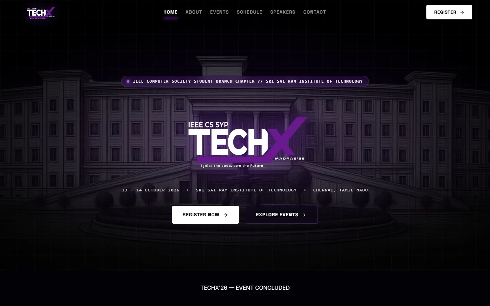

# TechX Madras ’26 — Official Website

**Ignite the code. Own the future.**

The official website for **TechX Madras 2026**, a two-day technology event organised by the **IEEE Computer Society Student Branch Chapter, Sri Sai Ram Institute of Technology**, Chennai, held on **13–14 October 2026**.



> The event has concluded. The site remains online as an archive of the programme, speakers and events.

---

## Features

- **Multi-page React app** with client-side routing: Home, Events, Event details, Schedule, Speakers, About, Venue, Contact and Register.
- **Data-driven event catalogue**: workshops, talks and competitions, each with rounds, rules and passes.
- **Registration** through KonfHub checkout links, with early-bird pricing, sold-out states and a time-limited offer modal.
- **Live countdown** to the event start.
- **Motion design**: branded loading screen, scroll reveals, custom cursor and animated backgrounds.
- **Responsive** layouts for mobile, tablet and desktop.

## Events

- VerdictX: Code & Conquer
- Sherlock & Syntax
- Idea Alchemy
- CodeNomics
- Edge AI & TinyML: AI Beyond the Cloud
- Nano Mentoring
- Benefits of IEEE Computer Society Membership

## Tech stack

| Layer | Technology |
|---|---|
| UI | React 19, React Router 7 |
| Build | Vite 8 |
| Icons | lucide-react |
| Lint | Oxlint |
| QA scripts | Playwright, Python |
| Hosting | Netlify (SPA redirect in `public/_redirects`) |

## Getting started

Requires Node.js 20 or newer.

```bash
npm install
npm run dev        # dev server at http://localhost:5173
```

Other scripts:

```bash
npm run build      # production build into dist/
npm run preview    # serve the production build locally
npm run lint       # run Oxlint
```

## Project structure

```text
Main Web/
├── public/                 # Favicons and Netlify _redirects
├── src/
│   ├── pages/              # Route pages (Home, Events, EventDetails, Schedule, …)
│   ├── components/         # Navbar, Footer, Countdown, EventCard, modals, effects
│   ├── data/               # Content: events, schedule, speakers, contacts, registration
│   ├── hooks/              # useRegistrationPricing, useScrollReveal
│   ├── assets/             # Logos and images
│   ├── App.jsx             # Router and global layout
│   └── main.jsx            # Entry point
├── scripts/                # QA and verification scripts (Playwright / Python)
├── docs/                   # Proposal, sponsor deck, design references, screenshots
└── assests/                # Sponsor template images
```

## Editing content

All event content lives in `src/data/`, so most updates need no component changes:

| File | Controls |
|---|---|
| `events.js` | Events, rounds, rules and registration passes |
| `schedule.js` | Day-wise timeline |
| `speakers.js` | Speaker profiles |
| `contacts.js` | Contact persons |
| `registration.js` | Pricing tiers and checkout links |
| `leadership.js`, `partners.js` | Organising team and partners |

## Deployment

The site is a static SPA. Run `npm run build` and deploy the `dist/` folder. On Netlify, `public/_redirects` sends every route to `index.html`, so deep links such as `/events/verdictx` work.

## Credits

Designed and built by **Balaharish Saravanan** ([@balax-24](https://github.com/balax-24)), Webmaster, IEEE Computer Society Student Chapter.
